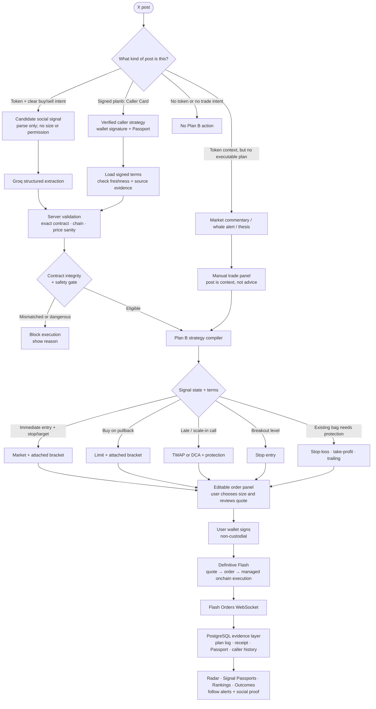

# Plan B

**Plan B is an X-native social trading product that turns a trading signal into a ready-to-sign, non-custodial Definitive Flash advanced order.** Trade a signal with a market, limit, TWAP, stop, bracket, or trailing strategy directly from X—after reviewing the plan and choosing your own size.

The Chrome extension is the in-context execution surface; Caller Cards, Radar, the validation backend, and Flash lifecycle tracking make Plan B a social trading product, not merely an extension. It is not an auto-trader and never custodians a wallet or private key.

The product principle is simple: social posts may suggest a strategy, but only the follower chooses size, reviews the exact asset and protections, and signs from their own wallet.

## Plan B in one minute

Plan B makes X a place to **plan and execute protected trades**, rather than a place to discover a ticker and rush into a generic market swap.

1. A post on X becomes a constrained strategy draft—not an instruction the app blindly obeys.
2. Plan B resolves the exact asset, checks contract integrity and token risk, then decides whether the post is a valid signal or only context for a manual trade.
3. It recommends the right Definitive Flash structure: market, limit, TWAP/DCA, stop entry, stop-loss, take-profit, bracket, or trailing protection.
4. The follower edits the plan, chooses their own size, and signs with their own EVM or Solana wallet. Plan B never holds keys or auto-trades.
5. The signal receives a Passport, and its source evidence, expiry result, caller record, and actual follower outcomes remain visible in Radar, Passports, Rankings, and Outcomes.

## Why Definitive Flash

Most tweet-to-trade products stop at “buy this token.” That is the wrong execution model for a social signal: a pullback needs a limit, a breakout needs a stop entry, a late call may need a TWAP, and a thesis with risk levels needs a bracket.

Definitive Flash is what lets Plan B treat those as real, managed onchain orders through one non-custodial integration across EVM and Solana. Flash provides the quote → wallet-signature → order-submission → lifecycle path for the advanced order types themselves; Plan B supplies the social interpretation, safety gates, accountability record, and follower-controlled execution policy around it.

## Why Plan B exists

Most social trading products reduce a post to a market-buy button or ask users to trust an opaque “signal score.” Plan B instead makes the **trade structure** the product:

- A caller says “buy ETH on a pullback, stop at X, target Y.” Plan B produces a Flash **limit + attached bracket**, rather than a market order that chases the price.
- A caller gives a breakout level. Plan B proposes a Flash **stop entry**, waiting for confirmation.
- The market has already moved. Plan B recommends a **TWAP + bracket** rather than pretending that the original entry is still available.
- A caller discusses an existing position. Plan B identifies it as **protection**, not a new buy.

That is what makes Plan B Flash-native: it uses advanced orders as the execution language of a social signal, instead of treating Flash as a swap API behind a generic trading UI.

## What is built

### 1. X post → validated draft

The Chrome extension adds a Plan B action only when a post is either:

- a signed `planb:<id>` Caller Card; or
- a clear trade candidate with a token/contract reference and trading intent.

Ordinary posts do not receive a trade button. Contextual posts which mention a token but do not contain enough executable detail open a clearly labelled **manual trade** panel instead of fabricating an order.

`POST /parse` sends untrusted post text—or a user-supplied voice transcript—to Groq with a strict JSON schema. Groq may extract only:

```text
token, chain, buy/sell, strategy type, entry type and price,
trigger, stop loss, take profit, trailing settings, duration,
expiry, confidence, missing facts, and ambiguous facts
```

The model never supplies a wallet, position size, or permission to trade. The backend treats all text as data, not instructions, and independently validates the draft before it reaches the signing flow.

### 2. Asset identity and validation

Plan B resolves a draft through Definitive Flash asset discovery and validates:

- chain support and exact token address;
- contract-versus-ticker integrity;
- current Flash price sanity versus stated levels;
- side-aware stop/target direction;
- required facts for the chosen order type;
- low confidence, missing facts, and ambiguous language.

An explicit contract address is never silently replaced with a same-symbol token. A ticker-only signal is visibly labelled `symbol_resolved`; an untradeable or mismatched contract is informational or blocked, never substituted.

Flash `/search` is the primary discovery source. If an API key is temporarily ineligible for search, DEX Screener can provide metadata only to keep the drafting experience usable; **Flash remains the quote and execution authority before signing**.

### 3. Flash advanced orders at the core

Plan B compiles a reviewed social draft into the correct Flash order recipe. The supported Flash order paths are:

| Signal situation | Plan B recommendation | Flash execution shape |
| --- | --- | --- |
| Immediate entry with stop and target | Protected entry | Market + attached bracket |
| “Buy the pullback at …” | Wait for the pullback | Limit + attached bracket |
| “Scale in over two hours” | Avoid one-shot execution | TWAP/DCA + attached bracket |
| “Buy only if it breaks …” | Confirm breakout | Stop entry |
| Existing tokens need downside protection | Protect position | Stop-loss, take-profit, bracket, or trailing stop |
| Price has moved materially from entry | Avoid chasing | TWAP recommendation with stated protection |

The advanced order compiler supports:

- market, limit, TWAP/DCA, and stop entries;
- stop-loss, take-profit, bracket, trailing-stop, and trailing-stop-limit protection;
- atomically attached brackets for same-chain market, limit, and TWAP entries;
- explicit follow-up protection when Flash cannot attach a bracket atomically;
- wallet-signed limit updates and wallet-signed bracket stop/target updates;
- canonical wallet-signed cancellation of open orders.

Flash handles routing and managed execution. Plan B obtains a quote, presents its terms, requests the required wallet signatures, submits the order to Flash, and tracks its lifecycle. On EVM this includes typed-data/personal-message and transaction signing paths; Solana uses the relevant message and transaction/delegation paths.

### 4. Non-custodial controls and safety

Plan B does not receive a user’s private key, choose their size, or submit a trade without their wallet confirmation.

Before a buy, the extension calls a backend security gate that combines:

- Flash asset/risk and liquidity information;
- GoPlus token-security analysis;
- Honeypot sell simulation on supported EVM networks.

Confirmed critical findings block the trade. Non-critical concerns are presented as warnings that require the user to acknowledge them. Canonical wrapped native assets are handled specially so a zero direct WETH-style row is not falsely treated as zero native-token liquidity.

Important execution notices are kept visible: first approvals may cost gas; gaps can cause protection to trigger immediately; and bought assets must remain in the signing wallet while attached protection is active.

### 5. Caller Cards and Signal Passports

A caller can create a structured strategy from [Caller Card](plan-b-landing-page/caller.html), sign a canonical message with their wallet, and publish the supplied X text containing `planb:<id>`.

Optionally, **World ID Proof of Human** can be required before a wallet may
publish a Caller Card. This makes caller reputation more resistant to Sybil
farms: World proves one unique human has enrolled the caller wallet, while the
wallet signature still binds every individual strategy. It does not claim to
prove ownership of an X account. See [World ID setup](docs/world-id.md).

Each saved signal has a **Signal Passport**. It can preserve:

- source post ID, URL, author handle, and SHA-256 text hash;
- exact asset contract, chain, contract-integrity verdict, and captured Flash price;
- side, entry, stop, target, order type, and validity window;
- source availability checks and source-verification state;
- a one-time post-expiry Flash mark-price direction result;
- append-only caller-signed revisions.

Source attestation requires the observed post to contain the exact `planb:<id>` reference. Plan B checks it immediately through X’s public embed endpoint and a bounded backend monitor rechecks attested sources every 15 minutes by default. It distinguishes:

```text
browser_observed · public_verified · public_available_unverified
unavailable · removed
```

“Removed” requires two consecutive public `404` checks. A temporary network/API failure is only `unavailable`.

Caller revisions do not rewrite history: the original Passport remains immutable, while each revised plan and reason receives a separately signed record.

### 6. Social trading without fake trust scores

Plan B separates evidence that should not be blended into one opaque number:

- caller wallet signature / verified Caller Card;
- historical signed-call mark-price outcomes;
- follower Flash execution outcomes;
- token contract integrity;
- token security risk;
- public source availability.

Only signed Caller Cards count toward a caller record. Parsed public posts are retained as **observed signals**, clearly labelled manual review, and never improve a caller’s reputation.

Caller profiles report `unscored`, `emerging`, or `established`. A caller needs at least five expiry-scored signed signals before a hit rate is presented as established. Chain and order-type history stay visible rather than becoming a synthetic “trust score.”

### 7. Radar, copy workflow, and notifications

The [Radar terminal](plan-b-landing-page/radar.html) provides separate feeds for signed Caller Cards and observed signals. It supports:

- freshness states: fresh, near entry, waiting, chasing, aging, and expired;
- filters for advanced order types;
- caller watchlists and followed-caller feeds;
- independent verified-caller swarms, such as multiple callers converging on the same asset;
- caller records, Passport visibility, strategy revisions, and Flash execution recommendations;
- follower counts and active / target-hit / stopped-out order data.

When a user follows a Caller Card from the extension, Chrome stores the wallet locally and polls the local backend once per minute. It sends native notifications only for new validated followed signals or new swarms—existing signals are seeded silently to avoid alert spam. Clicking an alert opens the exact source post (or Radar for a swarm). This works without X API credentials or an external push provider.

### 8. Product surfaces

The landing navigation exposes the social-trading evidence rather than leaving it only in storage:

- [Radar](plan-b-landing-page/radar.html) filters signed and observed signals, shows freshness, recommendation, contract-integrity result, revisions, source links, swarms, and follower activity.
- [Signal Passports](plan-b-landing-page/passports.html) show the evidence record: exact contract, Flash capture price, validity window, source and verification state, text hash, settlement result, and follower outcomes. Observed signals remain explicitly labelled and do not affect caller reputation.
- [Caller Rankings](plan-b-landing-page/rankings.html) rank callers only from actual resolved Flash follower outcomes.
- [Outcomes](plan-b-landing-page/leaderboard.html) show follower target-hit, stopped-out, and reliability results.
- [Create Caller Card](plan-b-landing-page/caller.html) is the signed strategy publisher, with World Proof of Human when configured.

### 9. Execution receipts and order lifecycle

After a user signs and submits a Flash order, Plan B stores a local plan record linked to the source signal and caller. It can retain:

- Flash order ID and attached bracket order ID;
- quote ID, quote time, estimated price impact, and estimated fees;
- fill price, fill fee, transaction ID, and updated order state.

The backend subscribes to Flash’s Orders WebSocket and maps order updates into local states such as waiting, entry filled, hit target, stopped out, cancelled, and failed. The in-X order drawer exposes open, resolved, and cancelled plans, cancellation controls, supported revisions, and shareable outcome text.

## System architecture



## Definitive Flash integration

Plan B uses Flash as the execution and advanced-order engine—not merely for pricing.

| Flash capability | How Plan B uses it |
| --- | --- |
| Asset search | Resolve candidates and validate exact contracts/chains |
| Quote | Show executable pricing, route/fee context, setup requirements, and bracket terms before signing |
| Order | Submit wallet-signed market, limit, TWAP, stop, protection, and bracket instructions |
| Order update | Revise an open limit order or attached bracket levels with a fresh wallet signature |
| Order cancel | Submit canonical wallet-signed cancellation requests |
| Balances | Populate selectable pay assets and wallet context |
| Orders WebSocket | Keep local plan lifecycle, social proof, and receipts current |

Supported Flash network availability is determined at runtime by Flash. The implementation is designed around the Flash catalog across EVM networks and Solana, including Ethereum, Base, Arbitrum, Optimism, Avalanche, BNB Chain, Polygon, HyperEVM, Ink, Monad, Plasma, Robinhood Chain, Arc, and Solana where Flash returns the asset/order route.

Reference material used by the integration is stored locally in [docs/definitive-flash](docs/definitive-flash/), including the LLM-oriented documentation index and OpenAPI specification.

## Local setup and demo

### Requirements

- Node.js 18+
- Chrome/Chromium
- An injected EVM wallet such as MetaMask/Rabby and/or a Solana wallet such as Phantom
- A Definitive Flash API key
- A Groq API key

### Backend

Create `backend/.env` from [backend/.env.example](backend/.env.example):

```env
DEFINITIVE_FLASH_API_KEY=
GROQ_API_KEY=
GROQ_MODEL=openai/gpt-oss-20b
GOPLUS_ACCESS_TOKEN=              # optional
SOURCE_MONITOR_INTERVAL_MS=900000 # optional; defaults to 15 min
EXTENSION_ID=                     # optional local CORS restriction
WORLD_APP_ID=                     # optional Proof of Human integration
WORLD_RP_ID=
WORLD_RP_SIGNING_KEY=             # backend-only secret
WORLD_ACTION=planb-verified-caller-v1
WORLD_ENVIRONMENT=staging         # simulator only; use production for live proofs
WORLD_REQUIRE_CALLER_VERIFICATION=false
```

Then run:

```bash
cd backend
npm install
node server.js
```

The backend listens on `http://localhost:8000`.

### Extension

```bash
cd extension
npm install
npm run build:solana
```

1. Open `chrome://extensions`.
2. Enable **Developer mode**.
3. Select **Load unpacked** and choose the `extension` directory.
4. Reload the extension and refresh X after any extension change.

Chrome Web Store submission is not required for a local or hackathon demo.

### Landing pages

```bash
cd plan-b-landing-page
python3 -m http.server 4173
```

Open:

- `http://127.0.0.1:4173/` — product landing page
- `http://127.0.0.1:4173/caller.html` — create and sign a Caller Card
- `http://127.0.0.1:4173/radar.html` — social signal Radar
- `http://127.0.0.1:4173/passports.html` — full Signal Passport evidence records
- `http://127.0.0.1:4173/rankings.html` — caller rankings from Flash follower outcomes
- `http://127.0.0.1:4173/leaderboard.html` — follower-outcome leaderboard

## API map

| Route | Purpose |
| --- | --- |
| `POST /parse` | Groq parse plus server-side Flash validation of a post or voice instruction |
| `GET /flash/search`; `POST /flash/quote`, `/flash/order` | Safe backend proxy for relevant Flash actions |
| `POST /flash/update-order` / `/cancel-order` | Wallet-signed Flash order maintenance |
| `POST /plans` / `GET /plans` | Create and read local Flash plan records |
| `POST /signals` | Create a wallet-signed Caller Card |
| `POST /signals/:id/source` | Attach and attest a published Caller Card source |
| `POST /signals/:id/revisions/*` | Create append-only caller-signed revisions |
| `GET /world/status`; `POST /world/rp-context`, `/world/verify` | World ID Proof of Human enrollment and verified-caller status |
| `POST /signals/capture` | Keep unsigned observed signals separate from caller reputation |
| `GET /signals/:id/passport` | Read a Passport; optionally refresh public availability |
| `GET /creators/:creator` | Read caller methodology-gated history |
| `POST /subscriptions` / `GET /radar` | Follow callers and fetch wallet-scoped Radar alerts |
| `GET /terminal?scope=verified|observed` | Public signed/observed Radar feeds |
| `GET /security/token/:chain/:address` | Run the multi-source pre-trade security gate |

## Safety and scope boundaries

- No trade is automatically signed or executed.
- Position size is always provided by the user; it is never parsed from a post.
- A social post is untrusted input, not financial advice.
- “Price in favor” on a Passport is a post-expiry mark-price measurement, **not** proof that a caller’s target filled.
- Actual follower target/stop outcomes come from Flash order events.
- A source check can establish public availability evidence; without X OAuth/API it is not a full proof of X-account ownership.
- PostgreSQL is the required runtime database. Legacy JSON is available only for the explicit one-time `npm run db:import-json` migration command and is never used as a runtime fallback.
- The local notification loop can alert on signals already known to Plan B. Fully automatic discovery of arbitrary KOL posts requires X API access and remains outside the current local build.

## Repository guide

| Area | Key files |
| --- | --- |
| Server, validation, and Flash proxy | `backend/server.js`, `backend/parser.js`, `backend/flash.js` |
| Advanced-order compiler | `backend/strategy.js` |
| Safety checks | `backend/security.js` |
| Plans, receipts, and Flash order stream | `backend/plans.js`, `backend/flash-stream.js` |
| Caller Cards, Passports, source monitor | `backend/signals.js` |
| Radar, subscriptions, and swarms | `backend/radar.js` |
| X UI, wallet interaction, in-X dashboard | `extension/x-ticker-swap.js`, `extension/bridge.js` |
| Background notifications and backend messaging | `extension/background.js` |
| Landing, Caller, Radar, Passport, ranking, creator and outcome pages | `plan-b-landing-page/` |
| Flash docs snapshot | `docs/definitive-flash/` |

## Verification

```bash
npm --prefix backend test
node --check backend/server.js
node --check extension/background.js
node --check extension/x-ticker-swap.js
```

The backend test suite covers parser safety/fallback behavior, security gates, native-liquidity handling, advanced-order compilation, Radar freshness/swarms, and Caller Card revision message binding.
